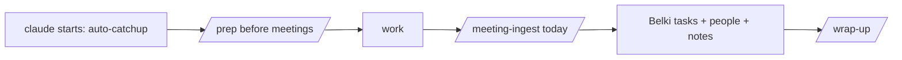

# Work kit

A copy-ready seed for a **work second brain** in RevOps: a private markdown repo on the company laptop
that Claude Code uses as working memory (glossary, stack map, meeting notes, stakeholders, tasks,
per-workstream STATUS). Generic on purpose: company specifics get filled in on day 1.

## Before day 1 (policy checks; any "no" changes the setup)

- [ ] Is Claude Code approved on the work laptop? On a **company** account (never a personal one)?
- [ ] Plan type: seat/subscription or metered API key? → sets the `Budget profile:` line (`BUDGET.md`).
- [ ] Which connectors are approved (CRM, call recorder, wiki, Slack)? Start read-only.
- [ ] Is a meeting recorder approved? What's the recording-consent policy?
- [ ] Where may a git repo live (local only, or a company-approved remote)? **Never a personal GitHub.**
- [ ] Python 3 installed? (Hooks are fail-open: without it they do nothing, and nothing breaks.)
- [ ] Obsidian allowed? Belki (the task UI) is an Obsidian plugin.
- [ ] OK to install unsigned local tools (Claude Code mods, an unpacked VS Code extension)?

## Setup

```bash
git clone https://github.com/projectsofwill/claude-os-starter.git
cp -R claude-os-starter/work-kit ~/work-brain   # includes the hidden .claude/ folder
rm -rf claude-os-starter
cd ~/work-brain && git init && git add -A && git commit -m "work brain: initial kit"
```

Then:

1. `bash setup/install-mac.sh --dry-run`, then without `--dry-run`: mods, statusline, VS Code launcher +
   keybindings, one memory store. Details: [setup/README.md](setup/README.md).
2. Install Obsidian, open `~/work-brain` as a vault, install the **belki** community plugin.
3. Paste your personal `working-style.md` and `brand-voice.md` into `context/` (email them to yourself;
   they're preferences, not confidential).
4. If the policy allows it, add Anthropic's document skills (Excel, PowerPoint, Word, PDF) for QBR decks
   and models:

   ```bash
   claude plugin marketplace add anthropics/skills
   claude plugin install document-skills@anthropic-agent-skills
   ```
5. Open `~/work-brain` in VS Code. Claude auto-launches; paste the prompt below.

<details>
<summary><b>Day-1 prompt</b></summary>

```text
This repo is my work second brain; read CLAUDE.md first. Set it up with me, one step at a time,
confirming before each write:

1. Interview me (short rounds) to fill context/about-me-work.md. Work-only: no personal-life detail.
2. Ask which budget profile applies (subscription or metered) and set the line in CLAUDE.md.
3. Replace the router placeholders (<Name>, <role>, <team>, <company>).
4. Ask what I know so far about the GTM stack and fill what I can in revops/stack-map.md; leave the
   rest as placeholders. Same for the <confirm> items in CONTEXT.md I can already answer.
5. Ask whether a git remote is approved. If yes, add it; if no, leave it local. Never a personal account.
6. Add today's onboarding next steps to projects/onboarding/STATUS.md and the root STATUS.md,
   and as Belki tasks with due dates via /todo.
7. Run the session-start hook once to confirm it works (python3 .claude/hooks/sessionstart_catchup.py
   < /dev/null), then commit.
```

</details>

## Daily loop



Skills: `/catchup`, `/wrap-up`, `/todo` (incl. `sweep`), `/prep`, `/meeting-ingest`, `/prompt-enhancer`,
`/grilling`, `/domain-modeling`, `/usage-cost`, `/writing-great-skills`. Deferred ideas: `BACKLOG.md`.
